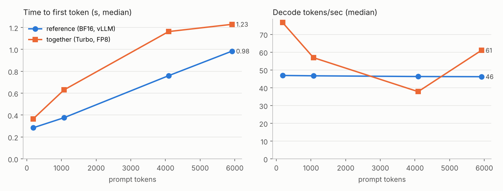

# together-parity

**Does Together AI's optimized serving change the answers?** A reproducible harness that
runs the same open model two ways — Together's API and the un-quantized weights on stock
vLLM — and tests, per prompt, whether accuracy or answer distributions diverge, then
measures how much faster Together is.

Together's claim under test: *faster inference at the same output quality.*
Together lists `meta-llama/Llama-3.3-70B-Instruct-Turbo` as an **FP8-quantized** variant,
so the reference here is Meta's released **BF16** weights. Same weights, different
precision and kernels — exactly what "same quality" has to survive.

## Result (Oct 8, 2026)

**Quality: equivalent within ±2 points.** GSM8K 96.2% (BF16) vs 95.7% (Together FP8);
HumanEval 86.6% vs 85.4%; pooled Δ −0.6 pp, 95% CI [−1.3, +0.1].
**Speed: 0.8–1.6× decode tokens/sec vs stock vLLM on dedicated 2× H100**, with slower,
more variable time-to-first-token. **Side finding:** Together's endpoint is not deterministic
at temperature 0 (25% of HumanEval code outputs changed between identical runs, vs 3.7% for vLLM).

Full tables: [`results/llama70b/RESULTS.md`](results/llama70b/RESULTS.md) · one-page writeup: [`WRITEUP.md`](WRITEUP.md)



## What it measures

| | How |
|---|---|
| **Accuracy** | GSM8K test (all 1,319) + HumanEval (all 164), greedy decoding, fixed seed, identical prompts on both endpoints. HumanEval graded by executing the hidden tests. |
| **Paired difference** | Δ accuracy per prompt with a 10,000-resample paired bootstrap 95% CI, plus an exact McNemar test on the discordant prompts. |
| **Equivalence** | "No significant difference" isn't proof of parity. Parity is claimed only if the 90% CI of Δ sits inside ±2 pp (TOST). Otherwise the verdict says *inconclusive*. |
| **Answer flips vs noise** | vLLM isn't bit-deterministic across batches either, so each endpoint runs twice. The test is whether Together changes answers *more often than the reference disagrees with itself* (bootstrap CI on the excess flip rate). |
| **Speed** | Time-to-first-token and decode tokens/sec at ~128 / 1k / 4k / 6k prompt tokens, 12 reps each after warmup, batch of one. Every request starts with a unique nonce so prefix caching can't hide prefill. Ratio-of-medians with bootstrap CIs. |

Reference weights come from `unsloth/Llama-3.3-70B-Instruct`, an ungated mirror of Meta's
BF16 release (set `PARITY_MODEL=meta-llama/Llama-3.3-70B-Instruct` plus an `HF_TOKEN` in the
secret to use Meta's repo directly).

Data files are vendored in `data/` and pinned by sha256; the run writes model IDs, server
`/version`, and timestamps to `results/<profile>/meta.json`.

## Run it

Needs Python 3.10+, a Together API key, and a GPU for the reference path.

```powershell
pip install -r requirements.txt
python -m pytest -q tests          # 16 tests, no network or GPU

# 1. Reference: Llama 3.3 70B BF16 on 2x H100 via Modal (see header of serve/modal_vllm.py)
modal secret create parity-ref VLLM_API_KEY=<pick-a-password>
modal serve serve/modal_vllm.py    # leave running; copy the URL it prints

# 2. In a second terminal
$env:TOGETHER_API_KEY = "..."
$env:REF_BASE_URL     = "https://<url-from-modal>/v1"
$env:REF_API_KEY      = "<VLLM_API_KEY from your Modal secret>"
python run.py check                                    # both endpoints answer?
python run.py quality --endpoint reference --n 20 --repeats 1   # smoke test
python run.py quality --endpoint reference             # full: 2 runs x 1,483 prompts
python run.py speed   --endpoint reference
python run.py quality --endpoint together
python run.py speed   --endpoint together
python run.py report                                   # -> results/llama70b/RESULTS.md + speed.png
```

Bash users: `export VAR=...` instead of `$env:VAR = ...`. Everything is resumable —
re-running a command skips finished prompts.

**Cheaper mode (8B):** `--profile llama8b` compares `Meta-Llama-3.1-8B-Instruct-Turbo` against
BF16 8B on a single 24 GB GPU (`bash serve/local_vllm.sh`) or on Modal with
`PARITY_MODEL=meta-llama/Llama-3.1-8B-Instruct PARITY_GPU=L40S:1`.

**Testing the actual "vs hyperscalers" claim:** add any OpenAI-compatible endpoint
serving the same model to `config.yaml` (e.g. a cloud provider's Llama 3.3 70B), run
`quality`/`speed` against it, then `python run.py report --ref <that-endpoint> --test together`.

### Cost

- Together: ~1.5M tokens for everything — a few dollars at most, inside free credits.
- Modal reference: 2x H100 for ~1–1.5 h including the first ~140 GB weight download,
  roughly $8–12 at Modal's H100 rate. Stop the app when the runs finish.

## Honest limits

- **Reference ≠ hyperscaler.** The speed numbers compare Together to a single-tenant stock
  vLLM deployment, not to AWS/Azure/GCP. That's a statement about Together's stack vs a
  strong open-source baseline, not a test of the "2–3x faster than hyperscalers" line
  unless a hyperscaler endpoint is added (above).
- **Batch-of-one latency only.** It says nothing about throughput or tail latency under load.
- **Client-side timing.** TTFT includes network RTT to each host; decode tokens/sec mostly doesn't.
- **Two benchmarks.** GSM8K and HumanEval probe math and code. FP8 effects can show up
  elsewhere (long context, multilingual, rare tokens) — the harness is task-agnostic, add more.
- **Contamination doesn't matter here.** Both paths run the same weights, so memorized
  answers cancel out in the paired comparison.
- **HumanEval executes model-written code** in a subprocess with a 10 s timeout.
  Run the harness inside a container or VM if that bothers you.

## Layout

```
run.py                 CLI: check | quality | speed | report
config.yaml            endpoints, sample sizes, seeds, margins
parity/client.py       streaming OpenAI-compatible client with TTFT / decode timing
parity/tasks.py        GSM8K + HumanEval loaders and graders (sha256-pinned data)
parity/stats.py        paired bootstrap, McNemar, TOST, flip-rate vs noise floor
parity/report.py       RESULTS.md tables + speed.png
serve/modal_vllm.py    BF16 reference on Modal (vLLM)
serve/local_vllm.sh    BF16 reference on your own GPU
tests/                 unit tests + a mock streaming server for end-to-end runs
```

Built by Ishaan Singla. MIT license.
